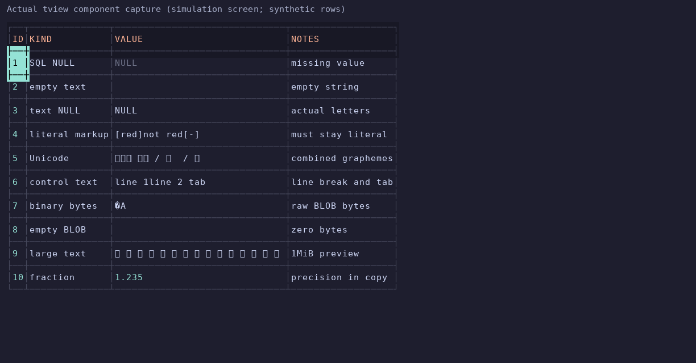
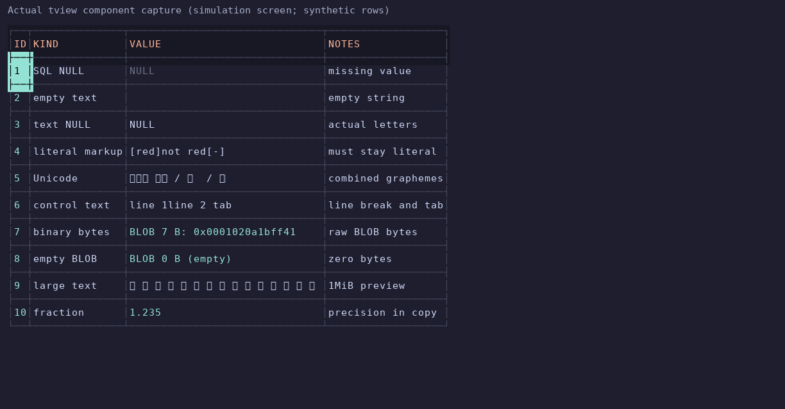
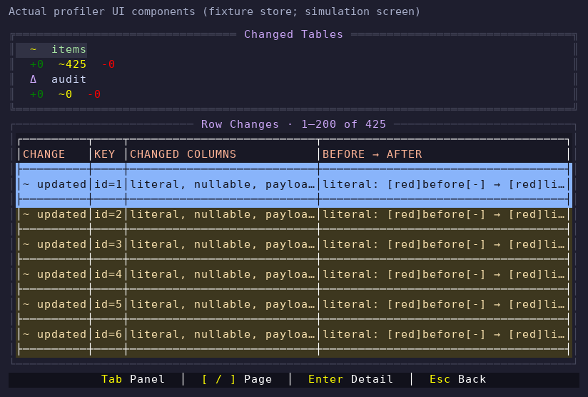
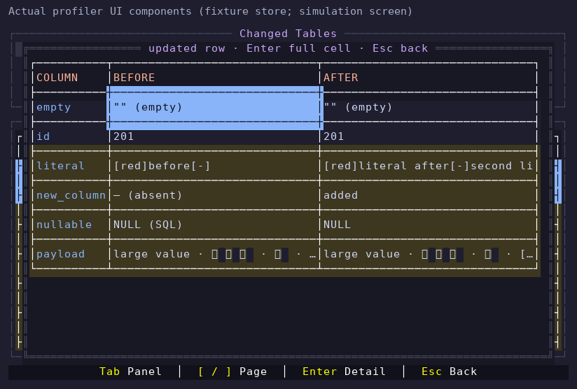
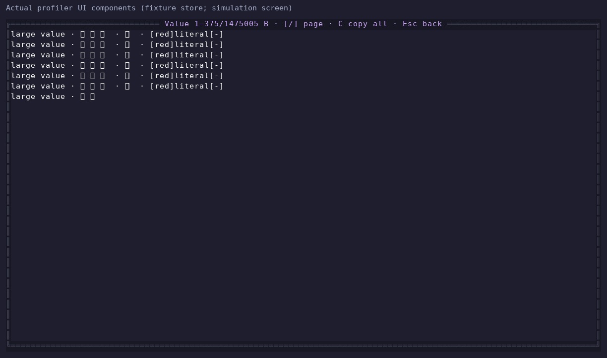
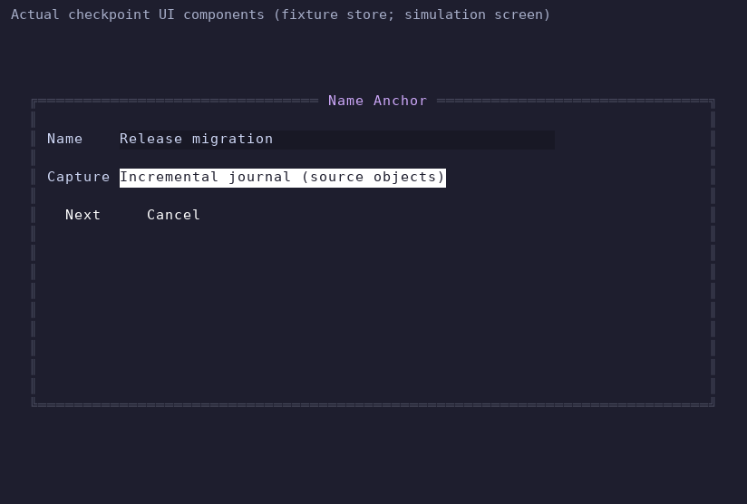
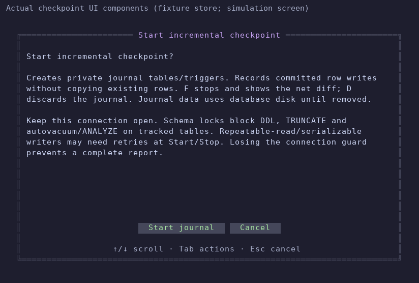
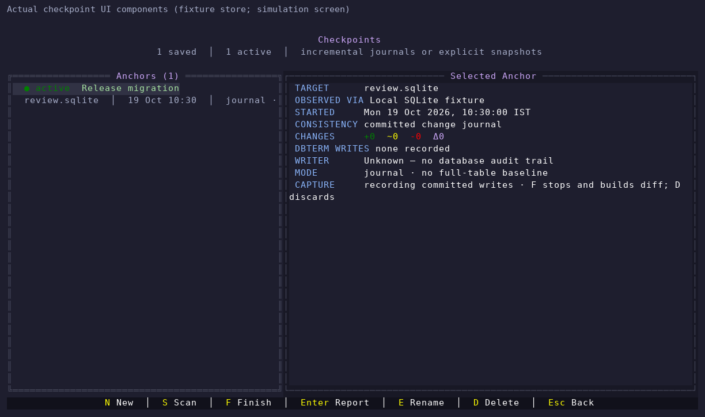

# Scalability and terminal component review

This review uses synthetic data and compares against commit
`17b33b429b1e088baf7b9541a3ba605e3fea4f47`. No user databases were accessed.
It covers checkpoint internals, result-table components, logical backup fidelity,
and restore cancellation. It is **not a completed end-to-end UX audit**: the
running cloud environment denies downloads of pinned SQLite/compression modules,
so the complete application and full checkpoint/backup workflows have not run.
The incremental journal adapters were separately exercised against official
PostgreSQL 17 and MySQL 8.4 containers, and SQLite through a standard-library
Python SQLite bridge. Those results are described below with their scope limits.

## What was exercised

Run `python3 scripts/review-fixtures.py --million` from the repository root.
The standard-library generator refuses to overwrite an existing output folder.
It creates an isolated connection profile under `.local/review/fixtures/config`.
Set `DBTERM_CONFIG_DIR` to that absolute path and use separate absolute
`DBTERM_STATE_DIR` and `DBTERM_LOG_DIR` directories when launching dbterm.

| Fixture | Rows in main table | File size | Purpose |
| --- | ---: | ---: | --- |
| Empty | 0 | 24 KB | Empty states |
| Small | 100 | 90 KB | Mixed values and everyday navigation |
| Medium | 10,000 | 6.9 MB | Paging and ordinary checkpoints |
| Large | 100,000 | 68.5 MB | Scan scaling |
| Million | 1,000,000 | 684.4 MB | Large local database |
| Catalog | 100, plus 200 tables | 934 KB | Long object lists |
| Wide | 1,000, plus a 150-column table | 22.2 MB | Wide results and long cells |

Fixtures contain Unicode/Indic/emoji, combining characters, literal color tags,
NULLs, empty strings, embedded NULs, multiline text, dates, JSON, BLOBs, composite
keys, keyless duplicates, and identifiers requiring quoting. Python SQLite
validated row counts, integrity, and representative stored values in all seven.
Database generation and integrity checks do not establish application readiness.

## Findings and changes

1. **Cell previews processed far more text than they displayed.** Producing a
   100-character preview repeatedly segmented the entire string and allocated
   storage for every grapheme. Preview construction now examines UTF-8 prefixes
   until it has sufficient complete grapheme boundaries. Full copy/export values
   remain separate. Indic conjuncts, ZWJ emoji, flags, long combining sequences,
   and malformed UTF-8 have regression coverage.
2. **Binary values were not readable.** The real table component rendered raw
   BLOB bytes as control/replacement characters; an empty BLOB looked like empty
   text. The revised display identifies binary values by size and hex preview.
3. **Large checkpoint reports were inaccessible beyond a fixed cap.** Reports
   now load 200 changes per page, show their position and total, and support
   `[`/`]` for previous/next pages. `Tab`/`Shift+Tab` switch panels. Row keys are
   displayed as key/value pairs instead of internal JSON metadata. Row details
   distinguish SQL NULL, empty values, and absent columns, escape literal markup,
   retain full cell values, and restore focus on return.
   On narrow terminals the table selector stacks above the report. Before/after
   columns share the available detail width and selection has an explicit
   foreground/background pair. Large cell values use bounded byte/grapheme
   windows with previous/next controls and full-value copy, rather than passing
   a multi-megabyte string into the text renderer.
4. **Highlights loaded only an initial slice of all changes.** Visible rows now
   use indexed key lookups, independent of their position in the saved report.
5. **Checkpoint preparation and comparison did unnecessary work.** SQLite
   boundary estimates use separate indexed MIN/MAX subqueries. Row normalization
   is shared with key encoding, and unchanged rows do not load saved value blobs.
6. **Repeated checkpoint scans could change their interpretation of the
   baseline.** Report-only metadata is now distinguished from captured tables.
   Deleting an anchor also removes its saved changes, schema events, activity,
   and temporary seen-row records in one transaction. Nullable SQLite primary
   keys, shadowed rowids, and literal dots in identifiers receive regression
   coverage. Older reports that already lost creation events cannot always have
   their original provenance reconstructed.
   Legacy SQLite anchors with a formerly assumed non-null primary key now
   require a fresh baseline explicitly; they preserve the old report instead
   of reporting every unchanged row as a deletion and insertion. The old anchor
   is marked failed, freeing its active-target slot for a replacement.
7. **Turso logical backups could change data on restore.** Embedded-NUL text,
   deleted AUTOINCREMENT high-water marks, and valid user objects beginning with
   `sqlite` without the reserved underscore are now preserved. User-table
   discovery uses the same literal reserved-prefix rule.
8. **Large SQL safety scans ignored cancellation.** PostgreSQL, MySQL, and SQLite
   restore scanners now check the restore context during streaming reads,
   including inside long literals, without weakening their safety checks.
9. **Local-service copy misled Docker users.** The panel now describes local
   service detection and directs Docker users to connect through published host
   ports. It does not claim to discover or control containers.

## Measured results and their limits

Measurements are from isolated helper/component harnesses on the review machine,
using the exact production functions. They are not end-to-end timings or service
level guarantees. Large input creation is excluded from timed preview loops.
The baseline preview used a single measured operation; updated previews used
100 ms benchmark runs, so ratios are indicative rather than statistically
controlled comparisons.

| Check | Baseline | Updated | Scope |
| --- | ---: | ---: | --- |
| 1 KiB ASCII preview | 2.005 s, 43.4 MB, 28,134 allocations | 0.271 ms, about 10 KB, 10 allocations | Preview helper |
| 1 MiB ASCII preview | Not run to completion | About 0.290 ms | Preview helper |
| 4 MiB ASCII preview | Not run to completion | About 0.366 ms | Preview helper |
| Primary-key encoding, 64 KiB row | 509.5 μs | 115.7 μs | Normalization/encoding; excludes compression/store |
| SQLite estimate, 1M-row/513 MB fixture | 117.5 ms | 0.004 ms | Warm query minimum, five samples |

The exact-source checkpoint component harness also caught a large-cell viewer
stall: drawing about 1.5 MB as one TextView was still running after 85 seconds.
The bounded cell viewer completes the same component traversal and exposes all
bytes through paging/full copy. This remains component testing with a fixture
store, not native database or full-application execution.

The separate real tview/tcell redraw benchmark found a **remaining bottleneck**:
at 120×36, a static 100×8 table with the default 30-cell column cap took about
20 ms for 16-character cells and 390 ms for 100-character cells. The local Unicode
compatibility layer recomputes boundary information while drawing. The preview
fix does not solve this redraw cost. It needs a focused Unicode/layout change
with broad boundary-conformance tests; replacing Indic-aware layout casually
would regress existing language support.
The grid's estimated byte budget also remains an estimate: retaining lossless
values means a few very large cells can exceed it. This patch does not claim a
hard memory ceiling for arbitrary result pages.

Executed checks include exact-source helper compatibility tests, standalone SQL
safety tests with race detection, Python SQLite round trips for logical-export
expressions, and production store migration/deletion SQL. Added full-package
regressions and workflow benchmarks remain unexecuted until module downloads work.
Do not treat blocked test packages as passing or count helper stubs as full-app
execution.

## Visual evidence and flow status











This is a current tcell simulation-screen capture of the production result-table
component with a synthetic SQL driver. It is not an OS-terminal screenshot or a
full application session. The rasterizer lacks some Indic/CJK/emoji glyphs; its
cell data retains the actual runes, so font fallback cannot be assessed here.
Checkpoint images use exact production UI methods with a controlled fixture
store and application shell. That harness passed page traversal, focus switching,
literal data, full-copy, and return-navigation checks at 80×24 and 120×32. Its
fixture store does not validate native database capture or the persisted diff
implementation. A focused large-cell TextView draw measured about 30–31 ms;
drawing its underlying report/detail layers as well took about 122–193 ms.

| Step | Status | Evidence or remaining work |
| --- | --- | --- |
| 1. Generate and validate varied databases | Passed | Seven fixtures, including 1M rows |
| 2. Inspect mixed-value result table | Component reviewed | 80×24 and 120×28 cell captures; binary ambiguity confirmed |
| 3. Start/Stop a checkpoint | Adapters and local lifecycle passed; full TUI flow blocked | Live PostgreSQL/MySQL SQL journals; SQLite bridge, reducer and Store tests; full package needs pinned modules |
| 4. Browse checkpoint report and row details | Component checks passed; full flow pending | Exact-source fixture-store keyboard tests and captures; pinned driver/compression still blocked |
| 5. Run, inspect, and restore a backup | Full flow blocked | SQL-expression round trips and safety scanner tests only |
| 6. Test native/cloud database integrations | PostgreSQL/MySQL journal adapters passed | Official disposable servers; hosted Turso/D1 and native backup/restore workflows unrun |

Keyboard and contrast checks on these components do not establish screen-reader
support or accessibility compliance. Color-only NULL distinctions in ordinary
result grids, control-character visibility, and Unicode font fallback still
need attention during a live-terminal pass.

## Incremental Start → Stop checkpoints







These images use the production methods with a fixture Store/App shell and a
tcell simulation screen. They validate component layout and keyboard behavior,
not a running full application or live database connection.

The default selectable journal mode now records committed row writes in private
source tables using engine-specific transactional triggers. It never copies a
full baseline. At Stop, the recorder establishes a durable boundary, reduces
only its events and saves the report before source cleanup. The old full-read
snapshot engine remains an explicit option for read-only/unsupported scopes and
schema comparisons; existing anchors retain their behavior. This patch consumes
SQL journals, not WAL/binlog replication feeds.

The reducer keeps the earliest before-image and latest after-image for each
changed identity. Insert/delete chains and reverted updates cancel out; key
moves split into delete/insert. SQLite replacement-conflict probes resolve only
affected identities with indexed point lookups at Stop. Unsupported key or
unique-index semantics fail visibly instead of silently falling back to a scan.

| Disposable million-row fixture | Start | Stop / read | Evidence |
| --- | ---: | ---: | --- |
| SQLite | ~7.2 ms | ~10.8 ms | One event and one exact net diff; actual production SQL/adapter via Python SQLite bridge |
| PostgreSQL 17 | ~34 ms | ~12 ms | Zero baseline rows, one event; actual adapter and production metadata helpers through lib/pq |
| MySQL 8.4 | ~58 ms | ~33 ms | Zero baseline rows, three events; actual adapter plus ownership checks through go-sql-driver/mysql |

These are single-container smoke timings under race detection, not full-app latency or general server
performance claims. Fixtures were generated before the timed boundary. Table
size is deliberately large while the write set is small. SQLite also exercised
1,000 and 100,000 existing rows with approximately constant Start/Stop work.
The permanent SQLite scale regression asserts zero baseline events and exactly
one final diff for one update; it logs timings without flaky speed thresholds.
Journal disk use depends on every recorded full row image; reducer memory depends
on changed identities. High write volume and very large changed values remain
material costs. The timings exclude TUI preflight, local compressed report
publication, and final journal cleanup where not part of the adapter boundary.

The final native runs passed 15 PostgreSQL tests and 13 MySQL tests with the Go
race detector. Saved outputs: [PostgreSQL](assets/journal-postgres-native.txt),
[MySQL](assets/journal-mysql-native.txt), [SQLite bridge](assets/journal-sqlite-bridge.txt),
[local lifecycle/locks](assets/journal-store-bridge.txt),
[reducer oracle tests](assets/journal-reducer.txt), and
[checkpoint UI components](assets/journal-ui-components.txt). Validation includes external writers, transaction rollback, key moves,
Unicode/BLOB/NUL values, large exact numerics, stable money/binary encodings
across writer settings, wide rows, replacement conflicts,
in-flight writes at Stop, frozen-boundary retry, lost-guard refusal, cancellation,
and cleanup failures. Reducer tests compare seeded write streams against an
independent final-snapshot oracle. Local Store tests cover consent, no baseline
rows, report-before-cleanup ordering, preserved prior reports, retry, deletion
protection and concurrent handles/processes. Store/SQLite tests use a Python
SQLite driver bridge and a raw-envelope codec in place of the unavailable pinned
SQLite/compression modules; they do not validate those modules or full linking.

Independent review found and fixed three continuity/ownership defects:

- PostgreSQL trigger disable/write/re-enable could hide writes while restoring
  the same trigger identity. A retained `SHARE UPDATE EXCLUSIVE` transaction now
  guards recording through the atomic frozen-gate commit. Tests prove trigger
  disable, DDL and TRUNCATE block, and loss of the guard refuses a complete diff.
- MySQL cleanup now re-derives names and verifies owner markers, exact table and
  trigger definitions and fingerprints before dropping anything. Replaced source
  objects remain untouched and recovery stays pending.
- SQLite cleanup removes verified orphan triggers when the journal table is
  missing; replacement trigger code is preserved and cleanup fails visibly.

These guarantees have operational costs. PostgreSQL/MySQL require a live guard
connection until Stop/discard and at least two pool connections. They block DDL
and TRUNCATE; PostgreSQL also blocks autovacuum/ANALYZE and may require higher
isolation writers to retry at Start/Stop. SQLite allows closing dbterm but rejects
schema changes during capture. PostgreSQL partitions/inheritance/RLS, MySQL
non-InnoDB/cascades, unsupported SQLite unique indexes and keyless scopes need an
explicit snapshot alternative. Hosted Turso behavior and MariaDB compatibility
were not established. The confirmation and [checkpoint guide](../change-profiler.md)
explain these limits and retained source-journal cleanup.

Backup review found another interaction: a full snapshot/dump can preserve
active checkpoint triggers, which would keep recording after restore without
local ownership metadata. Backup creation now refuses source journals and also
checks the captured SQLite catalog, frozen Turso schema, streamed MySQL SQL
(including split executable trigger comments), and PostgreSQL archive TOC before
publication. Captured-artifact checks cover journals that appear/disappear
between source preflight and completion; orphan triggers are checked too.
No application tables or data are stripped from an artifact.

Actual MySQL dumps with routines/events, strings resembling journal names and
orphan trigger fragments were accepted or refused as intended; actual PostgreSQL
archive TOCs were checked too. Exact snapshot/exporter/guard methods and all new
backup guard regressions passed through the Go-to-Python SQLite bridge alongside
NUL/AUTOINCREMENT/export/cancellation regressions. See the
[backup bridge output](assets/journal-backup-bridge.txt) and
[native dump parser output](assets/journal-backup-native-parsers.txt). These are
component/adapter checks, not complete native backup/restore workflows with
compression, encryption and publication. PostgreSQL backup now requires matching
`pg_dump` and `pg_restore` tools for captured-archive inspection.

Recorded dbterm write activity remains contextual evidence, not authenticated
writer identity. Backup activity records runs and attempts; agent logs are a
bounded diagnostic tail. These journals are temporary data-diff recorders and
are not incremental backups or point-in-time recovery. Artifact verification
also remains separate from proof that a recovery rehearsal succeeded.

## One feature proposal: recovery rehearsal receipts

Add a **Rehearse Restore** action to an existing backup artifact. Restore it into
a new disposable target, run integrity checks plus optional user-chosen
verification queries, and record a durable receipt. Keep this separate from the
artifact's existing checksum/format verification: a readable artifact and a
tested recovery are different evidence.

The receipt should identify the artifact and SHA-256, engine, disposable target,
start/end time, restore result, verification results, and cleanup result. Backup
Center can then show **Last artifact verified** and **Last recovery rehearsed**
as separate facts, with a details page that explains failures. Store summaries
and outcomes rather than row contents or credentials.

Start with local SQLite, which permits a truly isolated temporary target without
a separate service. Use the existing guarded restore pipeline and always require
a new target; never select a production connection automatically. Keep a failed
rehearsal's diagnostics and let the user choose whether to retain its target for
inspection. PostgreSQL/MySQL support can follow with explicitly configured
disposable databases and permissions.

Acceptance should cover successful mixed-type recovery, a corrupt/truncated
artifact, wrong encryption identity, cancellation, failed verification queries,
cleanup failure, and restart persistence. A green rehearsal must mean the restore
and its selected checks actually completed, with the artifact checksum tied to
the saved result. This proposal is documented, not implemented in this patch.

## Finishing the live review

Apply the saved `storage.googleapis.com` and `api.github.com` network settings to
the running environment. The former unblocks pinned modules; the latter is
needed for PR API access. Git read access alone does not establish PR permission.
Then run:

```sh
export PATH=/workspace/.tools/go/bin:$PATH
export GOMODCACHE=/workspace/.cache/go-mod GOCACHE=/workspace/.cache/go-build
export GOFLAGS=-mod=readonly GOMAXPROCS=4
go mod download
go mod verify
make build
go test ./...
go vet ./...
go test -race ./...
DBTERM_FORM_SNAPSHOTS="$PWD/.local/review/screens" go test ./internal/ui -run 'TestProfilerReport|TestProfilerDiffDetail|TestBackupSmallTerminal'
go test ./internal/ui -run '^$' -bench 'BenchmarkResultTextPreview|BenchmarkResultTableDraw' -benchmem
go test ./internal/changeprofiler -run '^$' -bench . -benchmem -benchtime=1x
```

Finally use the isolated profile in a real terminal, exercise every report page,
cancel a long capture/restore, restore into a disposable target, compare data,
and capture the dashboard, preflight, progress, report, details, backup outcomes,
and recovery navigation before calling the full UX review complete.
